<p align="center">
  
</p>

<p align="center">
  <b>Assistant de mode personnel propulsé par l'IA</b><br>
  Projet Advanced Data Science · ESPRIT
</p>

<p align="center">
  
  
  
  
  
  
  
  
  
  
  
</p>

<p align="center">
  <a href="#-démonstrations-vidéo">Vidéos</a> ·
  <a href="#aperçu">Aperçu</a> ·
  <a href="#le-problème">Problème</a> ·
  <a href="#la-solution">Solution</a> ·
  <a href="#architecture">Architecture</a> ·
  <a href="#résultats">Résultats</a> ·
  <a href="#confidentialité-des-données">Confidentialité</a> ·
  <a href="#installation-et-lancement">Installation</a> ·
  <a href="#équipe">Équipe</a> ·
  <a href="#limites">Limites</a>
</p>

---

AI-powered personal fashion assistant: build a digital wardrobe from clothing photos,
get outfit recommendations, plan outfits on a calendar (and see your avatar wearing them),
pack a suitcase for a trip, check whether a new purchase is worth it, donate what you no
longer wear, and — on the boutique side — manage stock and send clients personalized
style advice.

Project brief: `docs/DressMe.pdf` · architecture diagram: `docs/assets/dressme_architecture_current.png`
· personas & architecture deck: `docs/Copie de user persona architecture (1).pdf` ·
technical report: `docs/FINAL_REPORT.pdf`.

## 🎬 Démonstrations vidéo

Deux parcours filmés sur l'application locale, données de démonstration. Cliquez sur une
image pour lancer la vidéo.

<table>
  <tr>
    <td width="50%" valign="top">
      <a href="assets/videos/demo_01.mp4">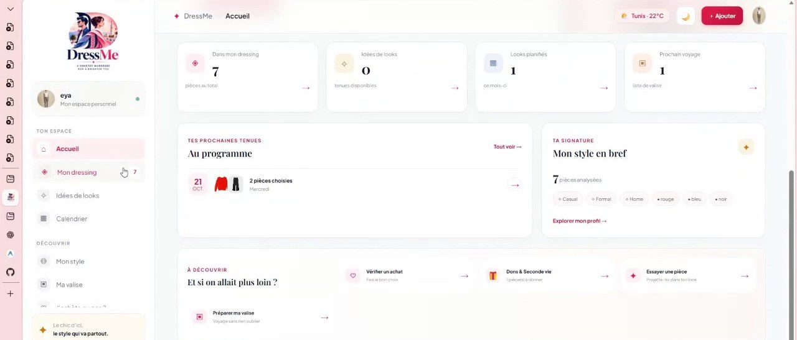</a>
      <br><b>▶ Parcours client</b> · 1 min 10<br>
      <sub>Tableau de bord, calendrier avec une tenue déjà planifiée, studio d'essayage
      virtuel (choix du mannequin, composition de la tenue), don d'une pièce et carte des
      points de collecte en Tunisie.</sub>
    </td>
    <td width="50%" valign="top">
      <a href="assets/videos/demo_02.mp4">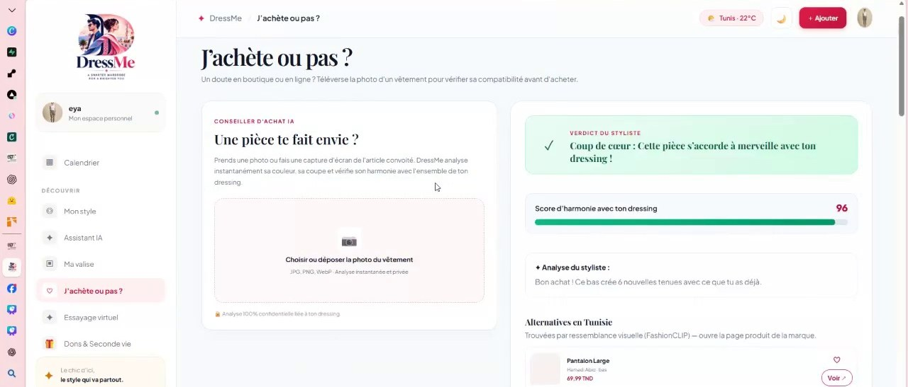</a>
      <br><b>▶ Espace boutique + "J'achète ou pas ?"</b> · 5 min 12<br>
      <sub>Tableau de bord du gestionnaire de stock, gestion des tailles, recommandation
      envoyée à un client ; côté client, vérification d'un achat par photo (score
      d'harmonie, alternatives trouvées par similarité visuelle) et produits de boutiques
      partenaires recommandés.</sub>
    </td>
  </tr>
</table>

## Aperçu

### Espace client

| Tableau de bord | Calendrier de tenues |
|---|---|
|  | 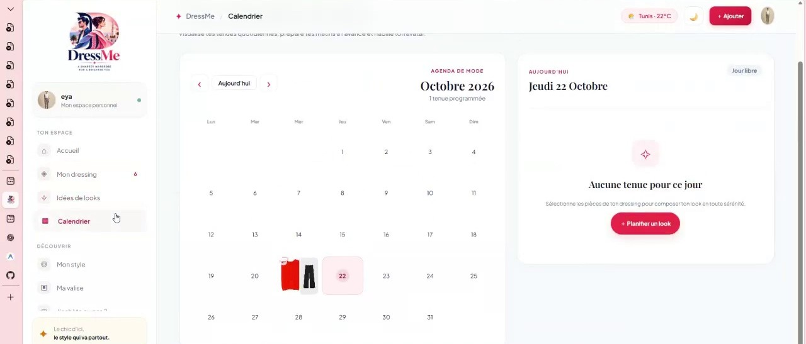 |

| "J'achète ou pas ?" — score d'harmonie et alternatives | Studio d'essayage virtuel |
|---|---|
| 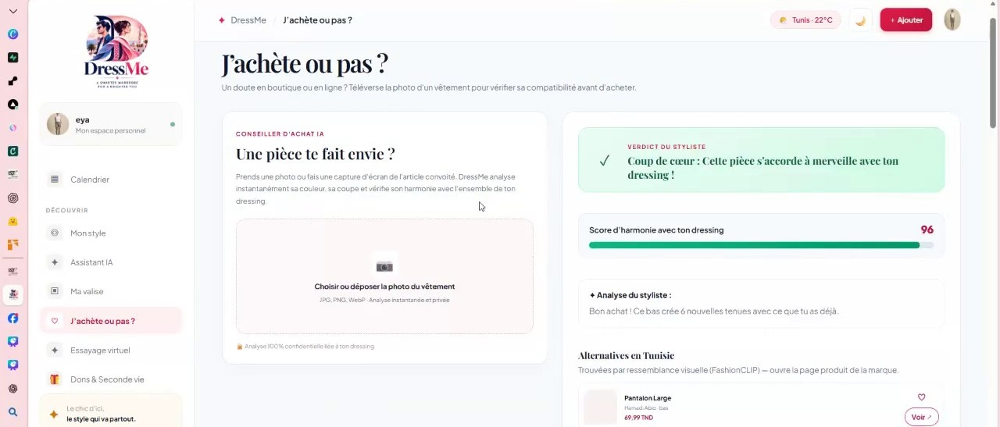 | 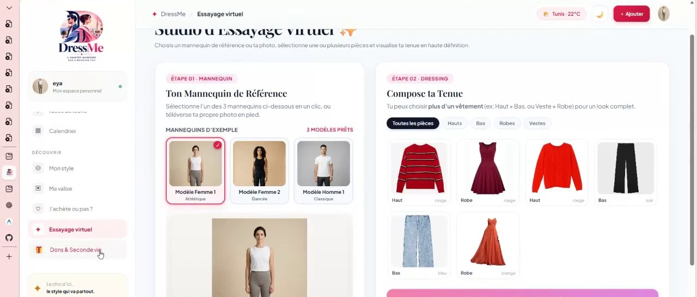 |

<details>
<summary><b>Dons &amp; seconde vie</b> (offrir une pièce plutôt que la supprimer, points de collecte par ville)</summary>

| Proposer un don depuis une pièce | Points de collecte en Tunisie |
|---|---|
| 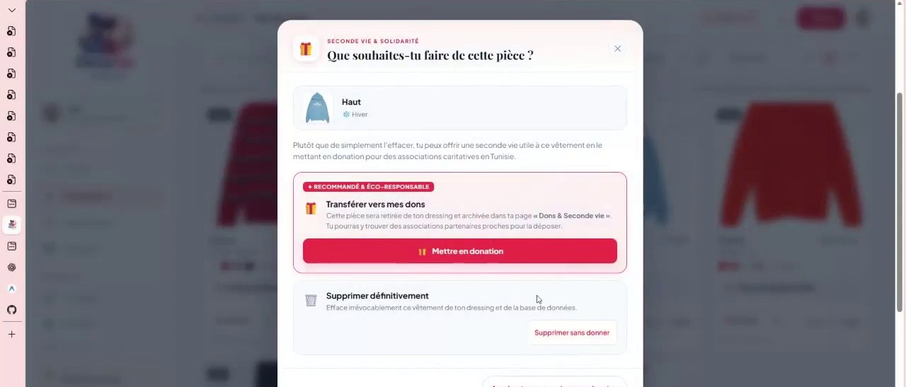 | 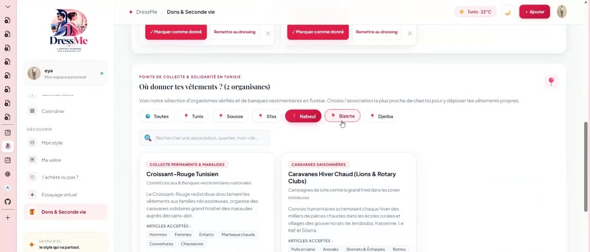 |

</details>

### Espace boutique (vendeur partenaire)

| Tableau de bord du gestionnaire de stock | Produits recommandés au client |
|---|---|
| 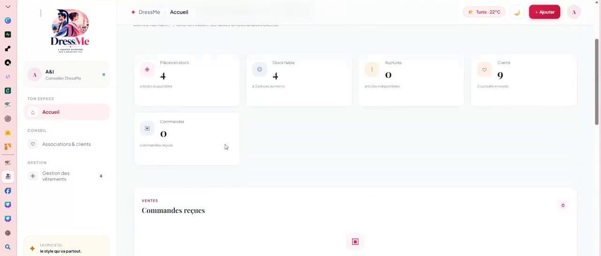 | 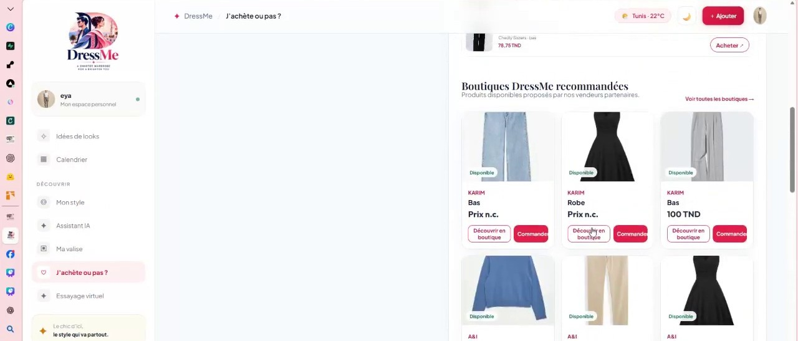 |

<details>
<summary><b>Gestion des tailles et du stock par produit</b></summary>

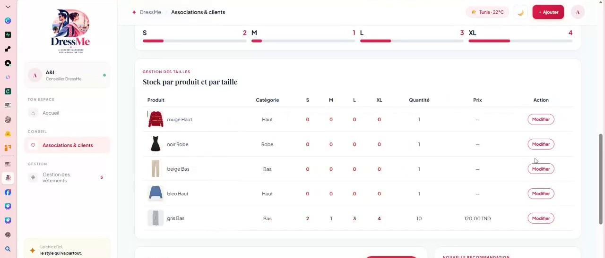

</details>

## Le problème

Les gens possèdent des vêtements qu'ils n'utilisent pas, et en achètent de nouveaux sans
savoir s'ils s'accorderont vraiment avec ce qu'ils ont déjà. Côté boutiques locales
tunisiennes, le lien avec le client reste souvent limité à la vente, sans visibilité sur
ce qu'il possède déjà.

## La solution

DressMe applique le principe **"exploiter d'abord, acheter intelligemment ensuite"** :
tirer parti de la garde-robe existante avant de recommander un nouvel achat.

| Côté | Ce que DressMe apporte |
|---|---|
| **Client** | Garde-robe numérique construite depuis des photos (catégorie, couleur, motif, style, saison avec un niveau de confiance), recommandations de tenues, calendrier avec rendu sur avatar, préparation de valise, vérification d'un achat avant de le faire, don des pièces non portées, assistant conversationnel. |
| **Boutique partenaire** | Suivi du stock par taille, alertes de stock faible, recommandations personnalisées envoyées à un client à partir de son profil, produits visibles dans le parcours d'achat du client. |

## Ce qui distingue DressMe

| | |
|---|---|
| 🧠 **Trois agents mesurés, pas seulement démontrés** | Vision (classifieurs entraînés sur ~8 900 photos tunisiennes), Recommandation (modèle de compatibilité entraîné sur 68 306 tenues Polyvore réelles), Achat (Qwen2.5-1.5B + LoRA, évalué sur des cas tenus à l'écart de l'entraînement) — résultats détaillés dans `docs/FINAL_REPORT.pdf`, pas seulement des affirmations. |
| 🎨 **Pipeline de garde-robe multimodal** | Contrôle qualité de la photo (flou, lumière), segmentation du vêtement porté (SegFormer-B2), palette de couleurs exacte (K-Means), détection de doublons et suggestions de pièces complémentaires par similarité visuelle. |
| 🤖 **Agent de recommandation en LangGraph (ReAct + styliste/critique)** | Filtrage réel par occasion (formalité extraite du texte libre) et par saison, règles d'harmonie des couleurs, variété entre les suggestions, plus un modèle de récompense RLHF appris par utilisateur. |
| 💬 **Agent d'achat qui n'invente rien** | Le score est une formule pondérée fixe ; le LLM appelle des outils dans un bac à sable et rédige l'explication, sans jamais décider seul du verdict. |
| 🔊 **Accessibilité** | Synthèse vocale (gTTS) pour les explications, interface en français. |
| 🇹🇳 **Catalogue tunisien** | Vêtements scrapés auprès de marques et boutiques locales (robots.txt respecté), utilisé pour les alternatives et les recommandations de boutiques partenaires. |
| 🔒 **Confidentialité par conception** | Le pipeline de vision ne transmet jamais de photo à un tiers ; l'option d'avis stylistique par LLM externe est désactivée par défaut et le signale explicitement. |

## Architecture

Les clients (web et mobile) appellent une API REST (`/api/v1`). L'intelligence mode vit
dans des agents spécialisés sous `backend/app/agents/`, coordonnés par un
`AgentOrchestrator`.

<p align="center">
  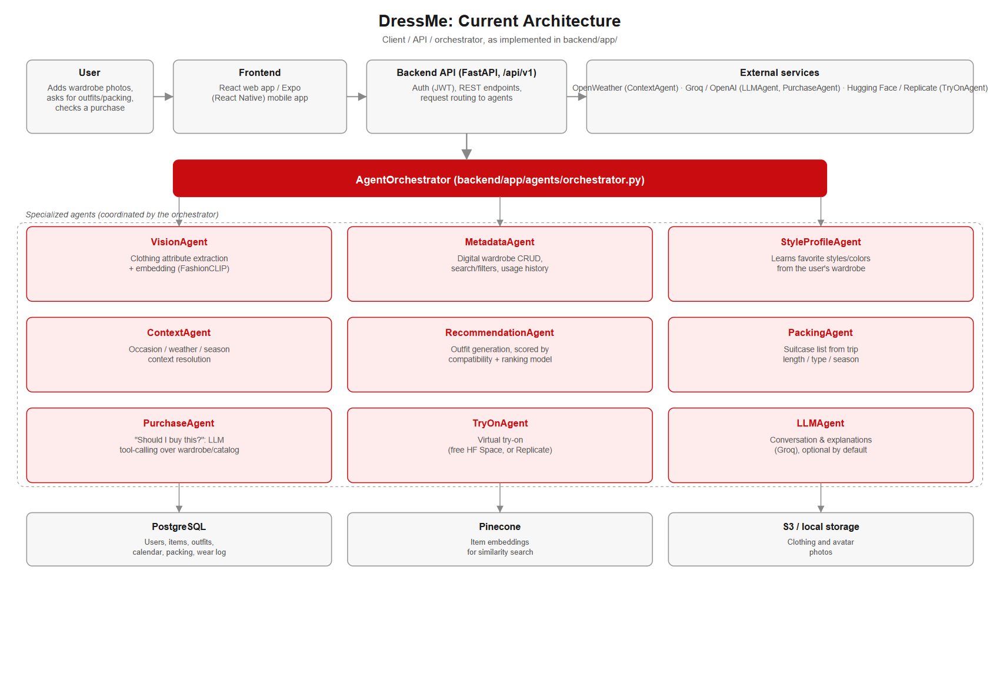
</p>

| Agent | Ce qu'il fait |
|---|---|
| **VisionAgent** | Embeddings FashionCLIP. Catégorie en deux étapes (un portier dit si c'est un vêtement, un SVM nomme le vêtement : ~87 % sur des photos tunisiennes tenues à l'écart) ; saison et style lus via le type de vêtement (suggérés seulement si confiants) ; couleur et motif en zero-shot. Chaque attribut a un niveau de confiance. Résultats mesurés : `ml/reports/vision_agent_evaluation.md`. |
| **WardrobeIngestionAgent** | Chaîne complète d'ajout d'une pièce : qualité de la photo, segmentation du vêtement porté, palette de couleurs K-Means, détection de doublons et pièces complémentaires par RAG. |
| **MetadataAgent** | La garde-robe numérique : ajout / correction / suppression, recherche et filtres, historique d'usage (calendrier + journal "porté"). |
| **StyleProfileAgent** | Apprend les styles et couleurs préférés de l'utilisateur à partir de sa garde-robe. |
| **ContextAgent** | Occasion / météo (OpenWeather) / saison. |
| **RecommendationAgentV2** | Construit des tenues notées par un modèle de compatibilité entraîné sur Polyvore, un modèle de récompense RLHF appris par utilisateur, et des règles contextuelles (couleur, saison, style) ; filtre vraiment par occasion et formalité plutôt que de les mentionner seulement dans le texte. |
| **PackingAgent** | Liste de valise selon la durée, le type de voyage et la saison ; inclut toujours les tenues déjà planifiées au calendrier. |
| **PurchaseAgent** | Vérifie un nouvel article face à la garde-robe et au catalogue (Qwen2.5-1.5B + LoRA pour les outils et l'explication, score toujours calculé par une formule fixe). |
| **TryOnAgent** | Essayage virtuel (Hugging Face Space gratuit, ou Replicate). Utilisé par l'écran Essayage et le rendu de l'avatar au calendrier. |
| **LLMAgent** | Conversation et explications en langage naturel (Groq), plus synthèse vocale (gTTS). Désactivable (`LLM_PROVIDER=none`). |

Données : PostgreSQL (utilisateurs, pièces, tenues, calendrier, valise, journal d'usage,
retours RLHF), Pinecone (embeddings des pièces), stockage S3-compatible ou dossier local
(photos).

## Résultats

Mesurés et documentés en détail dans `docs/FINAL_REPORT.pdf` ; résumé ici :

| Indicateur | Résultat |
|---|---|
| VisionAgent — catégorie, pièces gardées par le portier (1 380 photos tunisiennes tenues à l'écart) | **87,0 %** (vs 85,2 % avant les deux classifieurs ; gain non significatif statistiquement) |
| VisionAgent — couleur (zero-shot) | 67,9 % (Tunisie) / 70,4 % (Kaggle) |
| VisionAgent — style, précision équilibrée | 0,64 → **0,78** (via le type de vêtement) |
| RecommendationAgent — modèle de compatibilité (AUC, tenues jamais vues) | **0,675** vs 0,615 pour la similarité cosinus brute |
| RecommendationAgent — ranker contextuel (saison/occasion/météo appris) | AUC +0,007 : n'a **pas** passé son propre seuil de mise en production (+0,02 requis) — le runtime garde l'heuristique existante |
| PurchaseAgent (LoRA) — format des réponses / choix des outils / fidélité des chiffres cités | **100 % / 100 % / 0 %** sur 10 cas tenus à l'écart de l'entraînement |
| Suite de tests backend (après fusion du nouvel agent de recommandation) | **531 réussis**, 15 échecs, 21 erreurs, 12 ignorés — voir [Limites](#limites) |

Chaque résultat, y compris les moins bons, est détaillé et expliqué dans le rapport
technique plutôt que caché.

## Confidentialité des données

- Les photos de vêtements sont des données personnelles ; chaque garde-robe n'est visible
  que par son propre compte.
- Le pipeline de vision principal (FashionCLIP + classifieurs entraînés) n'envoie jamais
  de photo à un service tiers. Seule l'option *avis stylistique optionnel* (GPT-4o-mini)
  envoie une photo à OpenAI — **désactivée par défaut** précisément pour cette raison.
- L'agent conversationnel ne lit que les données du compte connecté et ne conserve pas
  l'historique de discussion dans une table de base de données.
- Le catalogue tunisien a été collecté uniquement sur les pages que le `robots.txt` de
  chaque site autorise explicitement, sans toucher aux comptes ni aux parcours de
  paiement.

## Installation et lancement

### Structure

```
backend/    FastAPI service: auth, wardrobe / outfits / calendar / packing / purchase / try-on
            APIs, plus the agent orchestrator (app/agents/)
frontend/
  mobile/   Expo / React Native app
  web/      React + Vite web app (same features as mobile)
ml/         Data understanding, scraping and training notebooks (research folder, not
            needed to run the app — trained artifacts are already in backend/app/ml/artifacts)
infra/      docker-compose: Postgres (+ the backend container)
docs/       project brief, personas, architecture, final report
assets/     README screenshots and demo videos
```

### Prerequisites

- **Docker Desktop** (for Postgres) — start it before anything else
- **Python 3.11+** (the Docker image uses 3.12) and **Node 18+**
- Several GB of disk for the Python dependencies (PyTorch) and the FashionCLIP model, which is
  downloaded from Hugging Face on first use

### Run it (local development)

Run the backend on your machine and Postgres in Docker. This is the setup the team uses and
gives you hot reload.

#### 1. Database

```bash
docker compose -f infra/docker-compose.yml up -d postgres
```

Postgres listens on `localhost:5432` (user / password / db: `dressme`). The data lives in
the `postgres_data` Docker volume and survives restarts.

#### 2. Backend

```bash
cd backend
python -m venv .venv
source .venv/bin/activate          # Windows: .venv\Scripts\activate
pip install -r requirements.txt    # large: includes torch

cp .env.example .env               # then edit it — see "Configuration" below
alembic upgrade head               # create / update the tables
uvicorn app.main:app --reload --port 8000
```

Check: <http://localhost:8000/health> returns `{"status":"ok"}`; interactive API docs at
<http://localhost:8000/docs>.

> **After every `git pull`, run `alembic upgrade head` again.** Other people's schema
> changes arrive as migrations in `backend/alembic/versions/`. If you skip it, the API
> fails with "column does not exist" errors.

#### 3. Web app

```bash
cd frontend/web
npm install
npm run dev
```

Open **<http://localhost:5173>** — use `localhost`, not `127.0.0.1`: the backend's CORS
allow-list only contains `localhost` origins. The API URL defaults to
`http://localhost:8000/api/v1` (override with `VITE_API_URL`, see `.env.example`).

#### 4. Mobile app

```bash
cd frontend/mobile
npm install
npm start          # then press w (web), a (Android emulator), or scan the QR code with Expo Go
```

The mobile app reads the API URL from **`frontend/mobile/app.json` → `expo.extra.apiUrl`**
(the `.env.example` next to it is not read by the code). It defaults to
`http://localhost:8000/api/v1`. On a **physical phone** `localhost` is the phone itself:
change it to your computer's LAN IP (e.g. `http://192.168.1.20:8000/api/v1`), and set
`PUBLIC_BASE_URL` in `backend/.env` to the same host so photo URLs are reachable too.

#### 5. Create an account

There is no seed data. Open the app, register with any email/password, then add a few
clothing photos from the Wardrobe screen. (`backend/scripts/seed_demo_wardrobe.py` can
seed a demo wardrobe for a faster walkthrough.)

### Run everything in Docker (alternative)

```bash
cp backend/.env.example backend/.env
docker compose -f infra/docker-compose.yml up --build
```

Starts Postgres and the backend on port 8000 (migrations run automatically at startup). You
still run the frontends with `npm` as above. The first build is slow (PyTorch); if the torch
download stalls, see the comment in `backend/Dockerfile` about pre-fetching the wheel into
`backend/wheels/`.

### Configuration (`backend/.env`)

Never commit `.env` (it is git-ignored). `backend/.env.example` documents every variable;
the ones you will actually touch:

| Variable | Needed for | Notes |
|---|---|---|
| `DATABASE_URL` | everything | Default matches the docker-compose Postgres. |
| `SECRET_KEY` | auth | Change it outside local dev. |
| `LOCAL_STORAGE_DIR` | **photo upload** (dev) | e.g. `./uploads`. Without a storage backend, adding a photo returns 503. Photos are served at `/media`. Use together with `PUBLIC_BASE_URL=http://localhost:8000`. |
| `AWS_*`, `STORAGE_BUCKET` | photo upload (real deployments) | S3 or S3-compatible. |
| `PINECONE_API_KEY` | **outfit recommendations, purchase check** | Free tier at pinecone.io is enough. Without it the app runs, but recommendations return no outfits (they need the stored embeddings) and the purchase check is degraded. |
| `OPENWEATHER_API_KEY` | weather by city | Optional; without it weather stays empty. |
| `TRYON_PROVIDER`, `HF_TOKEN` | virtual try-on / calendar avatar | `auto` uses Replicate if its keys are set, otherwise a **free** Hugging Face Space. `HF_TOKEN` (free account, read token) is optional but raises the daily GPU quota. Needs `LOCAL_STORAGE_DIR` too. |
| `REPLICATE_API_TOKEN`, `REPLICATE_TRYON_MODEL_VERSION` | try-on via Replicate (paid) | Optional. |
| `LLM_PROVIDER`, `LLM_API_KEY` | AI-written explanations | Optional, default `none`. |
| `CORS_ORIGINS` | browser clients | Add your deployed web origin. |

### Tests

```bash
cd backend
python -m pytest tests -q
```

- Most tests are fast and use an in-memory SQLite database.
- `tests/test_live_integration.py` runs against the real Postgres and real product photos
  from the internet, and exercises the real vision model — start Postgres first (it skips
  itself if Postgres isn't reachable).
- `tests/test_vision_agent.py` needs the local image set `ml/data/raw/tunisian_images`
  (git-ignored research data) and skips itself without it.
- Front ends: `npx tsc --noEmit` in `frontend/web` and `frontend/mobile` (the mobile app
  also has `npm run typecheck`).
- Current count after merging the v2 Recommendation Agent: see [Limites](#limites).

### Working on the code

- **Changed a model in `backend/app/models/`?** Add an Alembic migration in the same commit
  (`alembic revision -m "what changed"`, edit it, then `alembic upgrade head`). The schema in
  the database and in the models must stay identical, or the API breaks for everyone.
  Test your migration both ways: `alembic downgrade -1` then `alembic upgrade head`.
- List columns (colors, item ids) are stored as JSON text via the type decorators in the
  models, not as native Postgres arrays — keep it that way so the models also work on SQLite.
- New agent behavior goes in `backend/app/agents/`; routes in `backend/app/api/routes/` stay
  thin and call the agents or the orchestrator.
- One-off debug/inspection scripts go in `backend/scripts/debug/`, not the repo root; real
  training/eval entry points go in `backend/scripts/`.
- Run the test suite before pushing, and check both front ends type-check.

### Behaviors worth knowing

- **Uncertain photos:** if the Vision Agent is less than 50% sure of a photo's category
  (typically a photo of several pieces at once), `POST /wardrobe/` answers 422
  `low_category_confidence` and the apps ask the user to confirm the category. The 0.50
  threshold was calibrated on catalog-style photos and may need revisiting with real phone
  photos (`CATEGORY_MIN_CONFIDENCE` in `backend/app/ml/vision_model.py`).
- **Seasons:** `ete`, `hiver`, `mi_saison`, `toutes_saisons`. The model only *suggests* a
  season; the app shows "À confirmer" until the user picks one.
- **Calendar avatar:** `POST /calendar/{day}/render` dresses the avatar in the day's outfit —
  one try-on call per garment, a minute or more, so it only runs on request and the result is
  cached until the outfit or the avatar photo changes.

### Troubleshooting

| Symptom | Fix |
|---|---|
| `connection refused` on port 5432 | Docker Desktop isn't running, or the Postgres container isn't up: `docker compose -f infra/docker-compose.yml up -d postgres`. |
| `column ... does not exist` / `UndefinedColumn` | You pulled new code: `alembic upgrade head`. |
| Browser shows a CORS error | Open the web app at `http://localhost:5173`, not `127.0.0.1`. |
| Adding a photo returns 503 "storage isn't configured" | Set `LOCAL_STORAGE_DIR=./uploads` (and `PUBLIC_BASE_URL`) in `backend/.env`, restart the backend. |
| Recommendations return nothing | `PINECONE_API_KEY` isn't set (or the wardrobe has fewer than a top + bottom or a dress). |
| First photo is very slow | FashionCLIP is downloading from Hugging Face (one time). |
| `npm install` fails with `EPERM` / `EACCES` on Windows | Try `npm install --ignore-scripts` (this is what worked for us); also close anything scanning or syncing the folder (editor, antivirus, OneDrive). |
| Try-on fails with a quota message | The free GPU quota is used up — wait, or set `HF_TOKEN` to a free Hugging Face token. |
| Text-to-speech errors | `gTTS` needs an internet connection (it calls Google Translate's TTS endpoint); make sure it's installed (`pip install -r requirements.txt`). |

## Équipe

Projet développé par une équipe d'étudiants ESPRIT dans le cadre du module Advanced Data
Science Project. Zones de contribution, d'après l'historique git :

- **Eya Idi** — intégration de la garde-robe, tableau de bord boutique/styliste, flux de don
- **Tasnim** — PurchaseAgent (adaptateur LoRA, harnais d'évaluation, démo MCP)
- **Eya Rachdi** — RecommendationAgent (réarchitecture LangGraph, RLHF, synthèse vocale)
- **Sarah** — LLMAgent (conversation et narrations)
- Vision Agent, orchestrateur et infrastructure cloud — voir l'historique git pour le détail

## Limites

- La suite de tests backend compte, après la fusion du nouvel agent de recommandation
  (RecommendationAgentV2, RLHF, synthèse vocale), **531 tests réussis sur 579 collectés**
  (15 échecs, 21 erreurs, 12 ignorés). La majorité des erreurs vient de
  `tests/test_llm_integrations.py`, probablement des fixtures encore écrites pour l'ancien
  agent v1 — à corriger avant la soutenance.
- Le ranker contextuel du RecommendationAgent (saison/occasion/météo appris) n'a pas
  dépassé son propre seuil de mise en production ; l'heuristique existante reste utilisée.
- Aucun jeu de données étiqueté à la main n'existe encore pour mesurer la qualité des
  recommandations de bout en bout.
- La fidélité factuelle des explications rédigées par le PurchaseAgent (LoRA) est à 0 % sur
  les cas testés : le score reste fiable (formule fixe), mais le texte généré ne doit pas
  encore être pris au pied de la lettre pour les montants cités.
- Les seuils de confiance du Vision Agent ont été calibrés sur des photos de catalogue ;
  des photos prises au téléphone n'ont pas encore été utilisées pour les recalibrer.
- Détails complets, avec les preuves et les chiffres, dans `docs/FINAL_REPORT.pdf`.

---

<p align="center">
  <sub>DressMe · Advanced Data Science Project · ESPRIT</sub>
</p>
