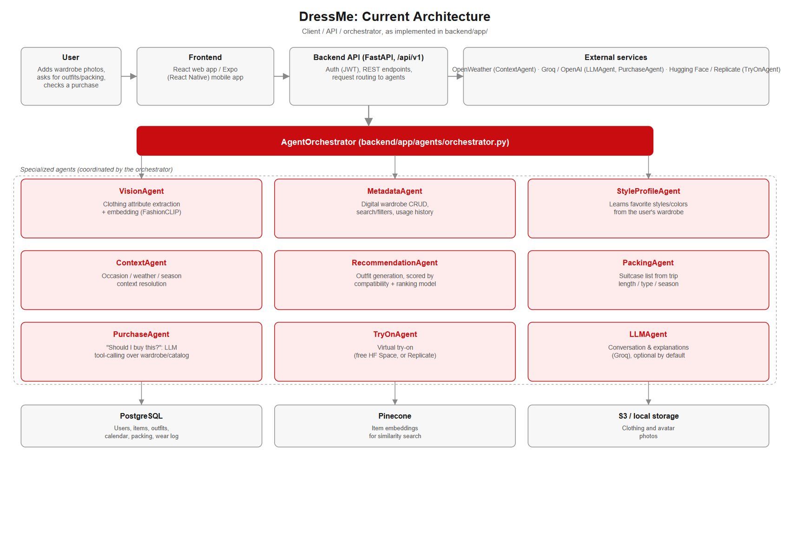

<div style="text-align:center; margin-bottom: 6pt;">

</div>

# DressMe: Personal Fashion Assistant

**Advanced Data Science Project, Final Technical Report**

**Module:** Advanced Data Science Project · **Date:** 10/11/2026

---

## 1. Problem statement

DressMe addresses a concrete, recurring problem: people own clothes they don't use, and
buy new ones without knowing if they'll actually combine with what they already have.
The project's stance, carried through every agent below, is **"exploiter d'abord, acheter
intelligemment ensuite"**: get value out of the existing wardrobe before recommending a
purchase.

What makes this a data science problem rather than a plain CRUD product is that none of
the core questions ("what do I own," "what goes together," "is this worth buying") can be
answered from structured fields alone. A photo has to be turned into attributes and a
vector representation before a wardrobe can be searched or compared (Vision Agent, §4); a
useful outfit suggestion needs a learned notion of visual compatibility, not just matching
tags (Recommendation Agent, §5); and a purchase verdict needs a model of the user's
existing wardrobe plus the market, not a fixed rule (Purchase Agent, §6).

### 1.1 Personas and business objectives

Built from the persona/architecture deck (`docs/Copie de user persona architecture (1).pdf`,
personas pages 8 to 12, objectives pages 14 and 15):

| Persona | Core need |
|---|---|
| Lina | Rediscover and vary outfits from what she already owns |
| Ahmed | Doesn't know which combination fits an occasion/weather/constraint |
| Maha | Wants a global view of everything she owns |
| Iskander | Wants to discover styles he likes, project himself before buying |
| Karim | Retailer/boutique persona; see the scope note below |

| Business objective | Data science objective |
|---|---|
| 01 Maximize value of the existing wardrobe | Attribute extraction, vector representation |
| 02 Personalized fashion experience | Dynamic user-profile modeling, contextual modeling |
| 03 Favor intentional purchases | Wardrobe-gap detection, purchase scoring |
| 05 Valorize the Tunisian fashion ecosystem | Local catalog data source |

### 1.2 Feature ideas traced to objectives

| Idea | Personas served | DS objective |
|---|---|---|
| Smart Wardrobe | Lina, Maha | Attribute extraction, vector representation |
| Smart Outfit | Lina, Ahmed | Vector representation, personalized ranking |
| Context-Aware Styling | Ahmed | Contextual modeling |
| Style Learning | Lina, Iskander | Dynamic user-profile modeling |
| Should I Buy This? | All | Vector representation, wardrobe-gap detection |
| Wardrobe Gap Detection | Ahmed | Wardrobe-gap detection |
| Local Fashion Matching | (supply-side) | Tunisian catalog data |
| Virtual Try-On | Iskander | *Scoped as "future exploration" at ideation time; has since shipped as the TryOnAgent (§3).* |

**Explicit scope decision:** Karim, the retailer persona, has no corresponding feature.
His needs (stock/size/quantity management, linking stock to outfit ideas) are
business-to-business and out of scope for this iteration; DressMe v1 is consumer-facing
only. This is a conscious call, not an oversight in the persona coverage.

---

## 2. Data understanding and preparation

Two very different data domains feed the project: public clothing-attribute datasets
(for training/evaluating the Vision Agent and seeding the Recommendation/Purchase agents
before any real user wardrobe exists) and a Tunisian local-catalog dataset (scraped,
since no public dataset covers this market and the project brief explicitly calls for it).

### 2.1 Sources and scale

| Source | Items | In-scope rate |
|---|---|---|
| fashion_products (Kaggle) | 44,424 | 87.5% |
| ileycom (scraped) | 4,744 | 26.1% |
| kontakt (scraped) | 3,063 | 76.6% |
| polyvore (outfit compatibility) | 2,900 | 75.0% |
| hamadi_abid (scraped) | 715 | 93.3% |
| chedly_sisters (scraped) | 269 | 89.6% |
| lyoum (scraped) | 186 | 60.8% |
| barsha (scraped) | 98 | 95.9% |
| noonclo (scraped) | 90 | 98.9% |
| myjebba (scraped) | 34 | 100.0% |
| rooh_clothing (scraped) | 9 | 0.0% |

**Total: 56,532 items across 11 sources.** "In-scope" means the item maps to a real
DressMe clothing category rather than `hors_perimetre` (out of scope). Polyvore in
particular was a general mood-board site, not exclusively fashion, so items that don't
match any DressMe category are routed to `hors_perimetre` rather than guessed.

Outfit-compatibility structure (Polyvore Outfits, official re-hosting of Vasileva et al.
2018): 596 outfits sampled for exploration, mean 4.87 / median 5 items per outfit; the
full dataset used for training is 365,054 items / 68,306 outfits (`ml/scraping/download_polyvore_official.sh`).

### 2.2 Data quality and gaps found during exploration

- The Kaggle attribute set has 143 article types, 73 with fewer than 50 samples, a
  long tail that needed merging into DressMe's coarser taxonomy
  (`ml/notebooks/04_taxonomy_reconciliation.py`).
- **Pattern** (stripes/plaid/floral/solid) isn't labeled in any public source, so it is
  resolved via FashionCLIP zero-shot weak-labeling instead of a labeled dataset.
- **Material** remains an open gap for v1: no source sufficiently labels this attribute,
  so DressMe does not currently expose a material field.
- Tunisian scraping only used pages `robots.txt` explicitly allows (checked per site, for
  example hamadi_abid's `Allow: /` with only account/cart/checkout disallowed), an ethics
  and ToS-compliance decision taken at collection time rather than an afterthought (§9).

### 2.3 Pretrained components used (not trained from scratch)

- **FashionCLIP** (`patrickjohncyh/fashion-clip`, MIT license, public, 2M+ downloads) is
  the image/text embedding backbone for the Vision Agent and the similarity search behind
  the Purchase Agent, used zero-shot or as a frozen feature extractor rather than
  fine-tuned, since no GPU was available in the development environment (§8).

Color and category labels are also unevenly distributed in the source catalogs: the
rejected color probe in §4.2 had as few as 7 violet, 9 red and 10 green training photos
against hundreds of black/white/blue ones, which is the direct reason zero-shot
comparison (not a trained classifier) was kept for color. The same long-tail pattern,
clothing catalogs are dominated by a handful of common categories and neutral colors,
recurs across every source in the table above (`ml/reports/catalog_categories.png`,
`catalog_colors.png`).

---

## 3. System architecture

Clients (web + mobile) call a REST API (`/api/v1`). Fashion intelligence lives in
specialized agents under `backend/app/agents/`, coordinated by an `AgentOrchestrator`.

| Agent | Role |
|---|---|
| VisionAgent | Clothing attribute extraction + embedding from a photo |
| MetadataAgent | Digital wardrobe CRUD, search/filters, usage history |
| StyleProfileAgent | Learns the user's favorite styles/colors from their wardrobe |
| ContextAgent | Occasion / weather / season context |
| RecommendationAgent | Outfit generation, scored by a trained compatibility + ranking model |
| PackingAgent | Suitcase list generation from trip length/type/season |
| PurchaseAgent | "Should I buy this?": an LLM tool-calling agent over the wardrobe and catalog |
| TryOnAgent | Virtual try-on (free Hugging Face Space, or Replicate) |
| LLMAgent | Natural-language conversation/explanations (Groq), optional by default |

Data stores: PostgreSQL (users, items, outfits, calendar, packing, wear log), Pinecone
(item embeddings for similarity search), S3-compatible storage or local folder (photos).



*Figure 1. Current architecture, redrawn from `backend/app/agents/` for this report. The
project's original ideation sketch (`docs/DressMe_architecture_4_agents.png`) showed a
core of four specialized agents plus the orchestrator and named Qdrant as the vector
store; the implementation kept the same client, API and orchestrator shape but grew to
the nine agents shown here, and settled on Pinecone for vector storage.*

### 3.1 Technology stack

The nine-agent design in Figure 1 is not a thin wrapper over one model: each agent
combines a different slice of the stack below, chosen per task rather than defaulting to
one toolkit everywhere.

| Layer | Technologies |
|---|---|
| Clients | React (web), React Native via Expo (mobile) |
| API and orchestration | FastAPI, JWT auth, a linear weather/filter/score/explain pipeline for the Recommendation Agent (§5.1) |
| Vision and embeddings | FashionCLIP (CLIP ViT-B/32 fine-tuned for fashion), OpenCV and PIL for photo quality checks, a SegFormer-B2 model fine-tuned for human parsing (garment segmentation), scikit-learn K-Means for color palette extraction |
| Classical ML | scikit-learn logistic regression and SVM (Vision Agent category classifiers, §4; Recommendation Agent compatibility probe, §5.2 and §5.3) |
| Deep learning | PyTorch: a Transformer-encoder SFT outfit-composition model (default scorer) and an opt-in PPO-clipped RLHF policy trained against a Bradley-Terry reward model (§5.1), degrading to a neutral score when a dependency is unavailable |
| LLMs and fine-tuning | Qwen2.5-1.5B-Instruct with a LoRA adapter (PEFT) for the Purchase Agent (§6), Groq-hosted `gpt-oss-120b`/`gpt-oss-20b` for the LLM Agent (§7), optional GPT-4o-mini for the Vision Agent's style fallback (§4.1) |
| Tool-calling infrastructure | MCP (Model Context Protocol), a stdio `FastMCP` server for the Purchase Agent's five tools, with a local-function fallback client (§6.5) |
| Retrieval and RAG | Pinecone (item embeddings), cosine-similarity KNN over the wardrobe for duplicate detection and complementary-piece retrieval, a text-embedding context layer grounding recommendations in the catalog and the user's scheduling/wear history (§5.1, §4.4) |
| Accessibility | gTTS (Google Text-to-Speech) for spoken explanations |
| Data and infra | PostgreSQL with Alembic migrations, S3-compatible or local object storage, Docker Compose, pytest for the backend test suite |
| External APIs | OpenWeather (context), Groq and OpenAI (LLM providers), Hugging Face Spaces and Replicate (virtual try-on) |

---

## 4. Methodology: Vision Agent

### 4.1 Approach

A photo is embedded once with FashionCLIP (512-dim vector); every attribute is derived
from that single embedding, never by re-analyzing the photo:

```
photo --FashionCLIP--> embedding (512-d) --+--> category    (2 trained classifiers)
                                            +--> color       (zero-shot)
                                            +--> pattern     (zero-shot)
                                            +--> style/season (via garment type, learned priors)
                                            +--> stored in Pinecone for similarity search
```

Three distinct techniques, deliberately not blurred together:

1. **Zero-shot** (color, pattern): no training data. One sentence per candidate value,
   compared to the image embedding via cosine similarity, softmax turns scores into a
   probability (which doubles as the confidence).
2. **Supervised learning on frozen embeddings** (category): FashionCLIP itself is not
   fine-tuned, since that would need a GPU and much more data. Instead two small
   classifiers are trained on top of its frozen output: a logistic-regression **gate**
   (8 classes, "is this even clothing") and an SVM **garment head** (7 classes, which
   garment), trained on about 8,900 Tunisian boutique photos (4,636 garments), with a
   proper train/validation/test split (hyperparameters tuned on validation, test used
   only to report results, and the shipped model retrained on train plus validation).
3. **Garment-type priors** (season, style): FashionCLIP directly answering "is this a
   summer garment?" gets 46% accuracy, *worse than always answering "summer."* Instead,
   the garment **type** is classified (about 40 types), and each type carries a
   season/style tendency learned from 44,000 products: `P(season|photo) = sum over types
   of P(type|photo) * tendency(type -> season)`.

An optional fourth path (`vision_llm.py`) sends the photo to GPT-4o-mini with a
versioned CRISPE prompt when FashionCLIP's style call is low-confidence; disabled by
default for privacy (see §9); every LLM answer is validated against the fixed value
lists, never trusted directly.

### 4.2 Results (held-out test sets, before vs. after)

**Category** (1,380 held-out Tunisian photos: 735 garments, 645 non-clothing):

| | accuracy, garments kept by gate | macro-F1, garments kept by gate |
|---|---|---|
| Before: 8-class linear probe | 0.852 | 0.851 |
| After: gate + SVM garment head | 0.870 | 0.871 |

That is +1.8 pt accuracy, 95% CI [-0.4, +4.2], which is **not statistically significant**
and is reported as such rather than oversold. Per-class F1 after: haut 0.861, bas 0.805,
robe 0.862, veste 0.707 (regressed from 0.762), chaussures 0.963, sac 0.940, accessoire
0.957.

**Season** (300 labeled Kaggle photos; majority-class baseline 0.507 accuracy):

| | accuracy | balanced accuracy |
|---|---|---|
| Before: zero-shot | 0.460 | 0.352 |
| After: via garment type | 0.480 | 0.477 |

Balanced-accuracy gain +0.126, CI [+0.047, +0.203], which is significant but capped by a
low ceiling: the Kaggle "season" label is a collection label, not a visually obvious
property.

**Style** (299 photos, Casual/Sports/Ethnic/Formal; majority-class baseline 0.779):

| | accuracy | balanced accuracy |
|---|---|---|
| Before: zero-shot | 0.585 | 0.642 |
| After: via garment type | 0.589 | 0.775 |

Balanced-accuracy gain +0.133, CI [+0.053, +0.215].

**Color** (zero-shot, unchanged): 67.9% on Tunisian photos, 70.4% on Kaggle. Five prompt
templates and a trained logistic-regression probe were tried and **rejected**: the probe
hit 69.5% on Tunisian test but only 47 to 56% on Kaggle, because the rare colors had too
few, imbalanced training labels (7 violet, 9 red, 10 green photos), so zero-shot was kept.

**Confidence gating in production:** category threshold 0.60, style 0.70, season 0.60,
chosen by measuring on labeled photos rather than guessed. Below threshold the agent
returns `None` and asks the user to confirm, rather than storing a guess.

### 4.3 Why these choices, anticipated questions

- *Why no FashionCLIP fine-tuning?* It needs a GPU and much more data; frozen-embedding
  linear/SVM probes are CPU-feasible, so full or LoRA fine-tuning is left as future work.
- *Why two classifiers for category?* The gate must also say "not clothing at all," while
  the SVM, trained only on garments, specializes in distinguishing between categories.
  The gain this split gives is modest and reported honestly as such.
- *Main limitation:* the evaluation uses catalog-style photos (one article per photo);
  real phone photos may shift these numbers, so the thresholds would need recalibration.

### 4.4 Wardrobe ingestion pipeline

The attribute predictions in §4.1 to §4.3 are one stage of a larger pipeline that runs on
every photo a user adds (`WardrobeIngestionAgent`, `backend/app/agents/wardrobe_ingestion_agent.py`),
combining four further pieces of engineering beyond FashionCLIP itself:

- **Photo-quality gate** (`cv_service.inspect_and_preprocess_image`, OpenCV and PIL):
  Laplacian-variance blur detection plus lighting and contrast checks reject or flag
  unusable photos before any model call is spent on them.
- **Garment segmentation** (`garment_segmentation.py`): a SegFormer-B2 model fine-tuned
  for human parsing (18 classes: upper clothes, pants, skirt, dress, shoes, bag, and
  non-garment classes such as hair and background) cuts the worn garment out of a photo
  of a person and pastes it on a white background, matching the catalog-style photos the
  Vision Agent's classifiers were calibrated on (§4.2). Since the model is trained on
  photos of people, it is skipped in favor of the whole image when no person is detected,
  which is the common case for flat product-style photos.
- **Color palette extraction** (`ml_color_service.extract_kmeans_palette`): K-Means
  clustering over the image's pixels produces an exact hex color palette, a separate,
  deterministic signal from the Vision Agent's zero-shot color classification in §4.2.
- **Wardrobe RAG service** (`wardrobe_rag_service.py`): cosine-similarity KNN against the
  user's existing wardrobe embeddings powers duplicate detection (flagged above a 0.82
  similarity threshold) and complementary-piece retrieval (for example a new top is
  matched against the user's existing bottoms, jackets, shoes and accessories); the
  retrieved context is then passed to the LLM Agent to generate an editorial item
  caption and instant outfit-pairing suggestions, grounded in pieces the user actually
  owns rather than invented ones.

This pipeline is the reason the Vision Agent's role in Figure 1 ("clothing attribute
extraction and embedding from a photo") undersells what actually runs on ingestion; the
attribute classifiers in §4.1 to §4.3 are the most rigorously evaluated part of it, not
the whole of it.

---

## 5. Methodology: Recommendation Agent

> **Revision note.** This section describes **RecommendationAgentV2**
> (`backend/app/agents/recommendation_agent_v2.py`), merged into `main` after the first
> draft of this report was written against the earlier LangGraph-based agent (v1). The
> merge (commit `387e0a5`) replaced v1 entirely; `AgentOrchestrator` now imports v2 under
> the same `RecommendationAgent` name. Everything below was re-verified against the
> current code, not carried over from the earlier draft.

### 5.1 Architecture

RecommendationAgentV2 is a linear pipeline rather than v1's LangGraph ReAct/critic graph:
**weather -> filter -> SFT scoring -> LLM validation -> explanation -> combine**. Each stage
is verified directly in the current code:

- **Real weather- and season-aware filtering** (`_filter_candidates`): candidates are
  excluded by *material* against the fetched temperature (linen below 5°C, wool above
  30°C) before the season filter is applied, falling back one stage at a time rather than
  to the full wardrobe. This is a strictly stronger use of weather than v1's: in v1,
  temperature only reached an unshipped contextual ranker and the explanation text; in
  v2, it is a real pre-scoring filter.
- **Occasion-driven constraint parsing** (`ConstraintParser`, reused from v1): free-text
  requests are parsed into structured constraints including `formality`, which still
  drives filtering. The sportswear-at-a-wedding fix (commit `b009e12`) is preserved by
  this mechanism.
- **SFT outfit-composition scoring** (`outfit_composition_sft_model.py`): a Transformer
  encoder trained with cross-entropy loss to imitate good combinations, on Polyvore
  outfits plus labeled Tunisian wardrobe compositions, persisted per user
  (`artifacts/outfit_composition_sft_{user_id}.pt`). This is v2's default scorer.
- **Optional RLHF policy model** (`rlhf_policy_model.py`): a PPO-clipped policy (ratio
  clipping plus an entropy bonus, the standard PPO-clip objective) trained against a
  **Bradley-Terry reward model** (`preference_reward_model.py`, unchanged from the signal
  already documented in the first draft of this report: Adam, lr=1e-4, 20 epochs, on
  (preferred, rejected) outfit pairs from a user's own like/dislike feedback). The load
  order in `_load_models` is **RLHF policy -> SFT -> a neutral 0.7 fallback**, but the
  policy is only attempted when `USE_RLHF_MODEL=true`, which **defaults to false**: SFT
  is what actually scores outfits for a user who hasn't opted in, and the training script
  (`backend/scripts/train_rlhf.py`) must be run per user before a policy checkpoint
  exists at all.
- **Contextual compatibility boosts** (`backend/app/ml/compatibility_model.py`,
  unchanged from v1 and still called by v2's `_score_outfit_compatibility`): on top of
  the trained pairwise compatibility score (§5.2), each candidate pair is
  multiplicatively adjusted by a season-compatibility factor, a **color-harmony factor**
  (shared colors or a neutral such as black/white/gray/beige boost the score), a
  style-coherence factor, and a pattern-clash penalty.
- **Optional LLM validation** (`_score_with_llm`, via `app.ml.recommendation_llm`): when
  an `llm_agent` is supplied, composed candidates get an additional LLM-scored pass
  before the final explanation is generated.
- **RAG grounding**, unchanged from v1 and orchestrator-level rather than
  agent-specific (`backend/app/rag/context_retrieval.py`, called from
  `AgentOrchestrator`, not from the agent itself): the mean Pinecone embedding of outfits
  the user has previously scheduled or actually worn, and a cross-modal search of the
  Tunisian catalog against a context text embedding (`ranking_model.context_vector`).
  Degrades to empty results rather than ever blocking a recommendation.

**A genuine piece of dead code found while verifying this**: `outfit_compatibility_transformer.py`,
documented in the first draft of this report as part of v1's reward layer, is no longer
imported by any production code anywhere in the backend (only by its own test file). It
was superseded by the SFT Transformer model above and should be deleted or explicitly
archived rather than left in `backend/app/ml/` looking load-bearing.

### 5.2 Compatibility model (notebook 09)

A linear classifier (logistic regression, class-balanced) on top of frozen FashionCLIP
embeddings, trained to tell "these two items were styled together in a real Polyvore
outfit" apart from "these two items are from unrelated outfits," using the element-wise
product of the two L2-normalized embeddings as its feature. Train/test outfits are
genuinely disjoint splits of the official Polyvore Outfits dataset (2,000 train outfits,
9,278 unique items; 400 test outfits, 1,899 unique items; seeded sampling, `RNG=42`).
Rerun for this report (`ml/notebooks/09_compatibility_model.py`, 38,228 train pairs /
7,620 test pairs, 50% positive in both):

| | accuracy | F1 | AUC |
|---|---|---|---|
| Trained compatibility model | 0.623 | 0.621 | 0.675 |
| Naive cosine-similarity baseline (threshold 0.415, picked on train only) | 0.586 | 0.606 | 0.615 |

The trained model beats the naive cosine-similarity baseline by +0.037 accuracy and +0.060
AUC on held-out, never-seen outfits. This is a real but modest gain: a linear probe on
frozen FashionCLIP embeddings captures some outfit-compatibility signal beyond raw visual
similarity, but is far from a strong classifier (AUC 0.675 is well short of what a
fine-tuned model or non-visual signal, such as co-purchase data, would likely reach). This
is the base pairwise score before the deterministic contextual boosts described in §5.1
are applied at inference time; the notebook evaluates the learned signal in isolation, not
the boosted score the running agent actually uses.

### 5.3 Contextual ranker (notebook 10)

A second, 2-feature logistic ranker adds a `context_fit` signal (a FashionCLIP text
embedding of a prompt such as "an outfit suitable for a summer wedding in hot weather,"
dotted with the mean outfit image embedding) on top of `visual_coherence` (the notebook 09
model). Occasion labels are not present in Polyvore and had to be synthesized from each
outfit's item composition (a dress-led outfit becomes `ceremonie`, top+bottom+jacket+shoes
becomes `travail`, otherwise `casual_quotidien`), so `sport`, `plage` and `voyage` are
barely coverable from this vocabulary. The notebook enforces a ship-gate: the learned
ranker is only promoted to production if it beats the `visual_coherence`-only baseline by
at least +0.02 AUC on held-out outfits; otherwise the runtime keeps its existing heuristic.
Rerun for this report (same train/test outfits as §5.2, 6,000 train rows / 1,200 test rows):

| | AUC |
|---|---|
| Ranker (visual_coherence + context_fit) | 0.595 |
| Baseline (visual_coherence alone) | 0.589 |
| Delta | +0.007 |

**Ship-gate: FAILED** (+0.007 AUC is below the required +0.02). The artifact was not
promoted to `backend/app/ml/artifacts/`; the runtime keeps the existing heuristic ranking,
exactly as the ship-gate is designed to do. This is a real negative result, not a bug: the
synthesized occasion labels are a weak signal, as the notebook's own design discussion
anticipated, and the `context_fit` machinery remains available for a future iteration with
real occasion labels rather than composition-derived ones.

While rerunning this notebook for the report, a genuine bug was found and fixed: the
random-assembly negative-example pool was being rebuilt from scratch inside the per-outfit
loop, an O(outfits^2) cost (about 4 million redundant calls for 2,000 training outfits) that
made the notebook impractically slow. It is now built once per split before the loop,
which does not change the model or its inputs, only the time to reproduce this result.

### 5.4 Feedback alignment and quality evaluation

`backend/app/agents/recommendation_evaluation.py` implements `feedback_alignment_at_k`,
called live by `AgentOrchestrator` to attach a signed overlap score between a user's
top-k recommended outfits and their past like/dislike feedback to each response. This
runs on real traffic, but produces a per-request number, not an aggregate benchmark
figure reportable here. No hand-labeled recommendation-quality set exists in the
repository (checked directly: no file anywhere under `ml/` or `backend/` matches this
description), and neither the SFT model nor the RLHF policy (§5.1) has a held-out
evaluation script or notebook, unlike the Vision Agent (§4) and Purchase Agent (§6):
their training scripts exist, but nothing in the repository measures, on data withheld
from training, whether the SFT or RLHF scorer actually improves outfit quality.
Recommendation quality for this report rests on the compatibility and ranking metrics in
§5.2 and §5.3, not on an end-to-end, human-labeled outfit-quality score.

---

## 6. Methodology: Purchase Agent

### 6.1 Architecture

The Purchase Agent checks a candidate item against the wardrobe and catalog. Its purchase
**score is a fixed weighted formula, never decided by the LLM**: versatility 40%,
uniqueness 25%, style fit 20% and price 15% (`FACTOR_WEIGHTS`,
`backend/app/agents/purchase_agent.py`), each factor itself computed deterministically,
for example versatility from how many owned pieces the candidate would pair with above a
calibrated compatibility percentile (§6.1a), and uniqueness from how similar the
candidate's FashionCLIP embedding is to the closest piece already owned (near-duplicate
above cosine similarity 0.95, redundant above 0.80). The LLM (Qwen2.5-1.5B with a LoRA
adapter) only calls tools and writes the explanation in French. Five small tools are
exposed (`inspect_wardrobe`, catalog lookup, price lookup, brand lookup, cost-per-wear),
four with no arguments and one (`limit`, default 20), deliberately minimal schemas rather
than a large JSON Schema. The orchestrating function (`evaluate_purchase`) is the sole
authority on the score; if the LoRA call fails, the score is unaffected and the
explanation falls back to a deterministic `_explain` path.

Reasoning uses a fixed system prompt (role, prohibition on inventing price, score or
brand, the tool list, the required tag format, a fixed tool-call order ending in a final
answer) with no runtime few-shot examples, so the ordering and format behavior come
entirely from fine-tuning rather than the prompt. A visual-similarity search
(FashionCLIP embeddings, k-nearest-neighbor over the wardrobe) feeds tool results as
JSON; the embedding vector itself never enters the LLM prompt, which is why this is
**not** a classic text-RAG pipeline (the project's own oral-prep notes explicitly flag
this distinction, and this report keeps it).

### 6.1a Score calibration

A raw compatibility probability only ever moves within a narrow band (roughly 0.45 to
0.65 on real data), which is not meaningful to show a user directly. `purchase_calibration.py`
turns each raw score into a percentile of a reference distribution built from 3,000
random pairings of real Tunisian catalog garments (`scripts/calibrate_purchase_agent.py`),
so a user sees "better than 85% of random combinations" rather than an opaque 0.58. If
the calibration artifact is missing, the module falls back to a linear min-max ramp over
each score type's observed range on the same catalog sample, so the agent never depends
on this artifact existing to produce an answer.

### 6.2 Fine-tuning (LoRA)

Qwen2.5-1.5B-Instruct with a LoRA adapter, trained on 25 synthetic teacher-generated
tool-calling trajectories (`r=16`, `dropout=0.05`). The project's own prep notes describe
25 examples as "enough for the format, too little for rich style," meaning the adapter
teaches *how to call tools and tag the output*, not fashion judgment: the numbers in any
answer come from the tools, not from what LoRA memorized.

### 6.3 Evaluation (held-out, honest reporting)

10 held-out purchase cases, outside the 25 SFT trajectories (`backend/scripts/eval_purchase.py`),
scored on three metrics against the real `run_agent` + tool sandbox:

| Metric | What it checks | Result (with LoRA) |
|---|---|---|
| Format | Every output is a valid `<tool_call>`/`<final>`, loop ends in `<final>` | **100%** |
| Tool choice | Only sandboxed tool names used, `inspect_wardrobe` called first | **100%** |
| Factual fidelity | TND amounts and median cited in the explanation match the tools' actual results | **0%** |

Reported limitations, stated plainly rather than hidden:

- All 10 traces follow the identical sequence of five tool calls, which looks like a
  learned habit rather than ten different pieces of reasoning.
- The 100% format score is partly helped by a tolerant parser that still accepts an
  unclosed tag, so that figure is, by the team's own account, a bit assisted.
- The LoRA call does not decide the score by design: a 1.5B model is prone to
  hallucination, which is exactly why the sandbox restricts it to tool calls and the
  score stays a fixed formula.
- A comparison run with the adapter disabled (`python -m scripts.eval_purchase --mode
  base`) has not yet been produced for this report, so the three metrics above should be
  read as the LoRA configuration's own result, not yet as a LoRA-versus-base claim.

### 6.4 MCP

An MCP (Model Context Protocol) server (`backend/app/mcp/purchase_server.py`, built on
`FastMCP`, stdio transport) wraps the same `PurchaseToolSandbox` used by the live agent,
exposing the same five tools under the same names and descriptions rather than a
reimplementation. `backend/scripts/demo_mcp.py` demonstrates the full round trip: it
opens an MCP session (`app.mcp.purchase_client.open_session`), lists the tools, calls
them, and parses a model-formatted action through the same `parse_action` function the
live agent's ReAct loop uses, all without loading Qwen. The live Purchase Agent loop does
not yet call tools through MCP: the server is a working demonstration of the same tool
contract, not (yet) the path the deployed agent actually takes.

---

## 7. Methodology: LLM conversational agent and other agents

### 7.1 LLM Agent (conversation and narratives)

Off by default (`LLM_PROVIDER=none`). When enabled, uses Groq `openai/gpt-oss-120b` for
free-text conversation (with `openai/gpt-oss-20b` as fallback on quota errors, one retry,
same local validation) and `gpt-oss-20b` for saved profile/outfit/purchase narratives.
The conversation reads the signed-in user's existing wardrobe/outfit/purchase data; it
does not recompute or rewrite any agent's decisions, and references to specific items are
validated against the wardrobe rather than trusted as written.

Documented real-call measurements (Groq, real account data, not mocked):

| Check | Result |
|---|---|
| Backend test suite, current `main` (commit `d41f21f`, after merging RecommendationAgentV2) | **531 passed, 15 failed, 21 errors, 12 skipped** (579 collected) |
| Backend test suite (mocked providers), recorded during LLM Agent integration, superseded by the row above | 252 to 280 passed depending on date/branch, 13 skipped |
| Real Groq call latency, styling question | 2.6 to 2.9 s |
| Real Groq call, fallback 20B | succeeded, 2 ideas |
| A fabricated claim about a rendered try-on, caught during testing | a targeted check and regression tests now refuse unverifiable rendering claims |

The current run's 21 errors are concentrated in `tests/test_llm_integrations.py`, almost
certainly fixtures still written against the deleted v1 Recommendation Agent rather than
v2; the 15 failures span `test_tryon_route.py`, `test_seasons_and_trip_planning.py` and
`test_purchase_history_route.py`. None of these were investigated individually for this
report; they are a concrete, scoped punch list for whoever owns each area before the
defense, not a sign the whole suite is unreliable (531 of 579 still pass).

**Explicitly stated limits, not glossed over:** this validation does not prove every
sentence of generated prose is correct, nor the quality of every piece of advice; the
assistant does not see images, does not browse the web or check live weather itself, and
does not replace the algorithmic ranking used elsewhere.

### 7.2 StyleProfileAgent, ContextAgent, PackingAgent, TryOnAgent

These four agents run in production alongside the three evaluated in detail above, but do
not yet have a dedicated quantitative evaluation write-up:

- **StyleProfileAgent** learns the user's favorite styles and colors from their wardrobe
  and feeds that profile to the Recommendation Agent's style bonus; covered by unit tests
  for its caching and per-user isolation, not by an accuracy metric (there is no ground
  truth for "preferred style" beyond the user's own future choices).
- **ContextAgent** resolves occasion, weather (via the OpenWeather API) and season into the
  structured context the other agents consume; its own logic is deterministic lookups and
  unit-tested, so its correctness is a code-review question rather than a measured one.
- **PackingAgent** builds a suitcase list from trip length, type and season, always
  including outfits already planned in the calendar; validated by unit tests over fixed
  trip scenarios rather than real-user usage data.
- **TryOnAgent** renders the avatar in a given outfit via a free Hugging Face Space (or
  Replicate); validated manually by inspecting rendered output and by the free-tier quota
  behavior documented in the README's troubleshooting table, not by an automated metric.

Reporting this plainly: these four agents are functionally tested (the backend suite
exercises their code paths) but not evaluated the way the Vision, Recommendation and
Purchase agents are in §4 to §6.

---

## 8. Critical analysis and limitations

### 8.1 Limitations by agent

Collected from what has already been measured and documented, rather than written
generically:

- **Vision Agent**: results come from catalog-style photos, one article per photo; real
  phone photos may shift the confidence calibration (0.60/0.70/0.60 thresholds). Season
  and style ceilings are capped by imperfect ground truth, since season is a collection
  label rather than a visible property. Pattern has no ground truth at all, only weak
  zero-shot labels. Color classification is stuck around 70% despite several tried
  improvements (§4.2).
- **Recommendation Agent**: weather now genuinely filters candidates by material (not
  just the explanation text, §5.1), and occasion (via formality), style and season are
  real hard filters too; the sportswear-at-weddings bug (commit `b009e12`) is fixed by
  this mechanism, though no systematic audit confirms every occasion combination is
  covered. The default scorer (SFT) and the opt-in RLHF policy both lack a held-out
  evaluation (§5.4), unlike the Vision and Purchase agents: nothing in the repository
  measures whether either one actually improves outfit quality. The base pairwise
  compatibility model beats a naive baseline only modestly (AUC 0.675 vs 0.615, §5.2),
  and the learned contextual ranker from notebook 10 did not clear its own ship-gate (AUC
  delta +0.007 vs the required +0.02, §5.3). A genuine piece of dead code
  (`outfit_compatibility_transformer.py`, superseded by the SFT model but still present
  and still imported by its own test) was found while re-verifying this section after the
  v1-to-v2 merge, and should be removed. This agent was substantially rewritten between
  the first and current draft of this report (v1 to v2, §5's revision note); treat the
  numbers above as current as of commit `d41f21f`, not as a stable, long-measured
  baseline the way §4's Vision Agent numbers are.
- **Purchase Agent**: factual fidelity of the LLM's written explanation is currently 0% on
  held-out cases; the score itself is unaffected, since it is a fixed formula, but the
  prose cannot yet be trusted to cite the right numbers. All 10 held-out traces follow an
  identical tool-call pattern, suggesting the LoRA adapter learned a fixed habit rather
  than case-by-case reasoning. MCP is demonstrated but not wired into the live loop.
- **LLM Agent**: validation covers format and reference correctness, not prose
  truthfulness in general. One fabrication was caught and patched, which by construction
  blocks others of the same shape, but does not establish that no other failure mode
  exists.
- **Cross-cutting**: no GPU was available during development, so every component meant to
  run in production by default (category classifiers, the LoRA adapter, the two
  Recommendation Agent linear probes) was deliberately chosen to be feasible on CPU or
  small compute; this is the most likely reason the probes in §5.2 and §5.3 only modestly
  beat their baselines. The heavier PyTorch components (the Transformer compatibility
  scorer and the RLHF preference model, §5.1) exist specifically as optional layers that
  degrade to the lighter scorers when unavailable, rather than being assumed to always
  run, for the same reason. Full FashionCLIP fine-tuning remains out of reach without new
  infrastructure.
- **Persona coverage**: Karim, the retailer persona, has no corresponding feature; stated
  as a conscious v1 scope decision rather than a miss (§1.2).

---

## 9. Ethics, data governance, and confidentiality

- Clothing photos are personal data; the app's wardrobe is self-uploaded by the account's
  own user, with no cross-user data use.
- The optional LLM-vision path (`vision_llm.py`, GPT-4o-mini style opinions) sends a photo
  to OpenAI, which is why it is **disabled by default**; the core vision pipeline
  (FashionCLIP plus the trained classifiers) never sends photos to a third party.
- The LLM conversational agent reads only the signed-in user's own account data and does
  not persist chat history to a new database table, keeping it in page memory only.
- Tunisian catalog scraping (`ml/scraping/`) only targeted pages each site's `robots.txt`
  explicitly permits, checked per site (for example hamadi_abid's `Allow: /` with only
  account/cart/checkout excluded), and collected public catalogue data only, with no
  accounts or checkout flows touched.
- No personal data beyond a user's own uploaded wardrobe photos and account details
  (email, password hash) is stored; the module's own confidentiality requirement is met by
  the points above, since the only personal data in the system is what each user
  voluntarily uploads about themselves.

---

## 10. Conclusion and future work

DressMe set out to answer three questions with data, not just rules: what does a user
own, what combinations work, and is a new purchase actually worth it. The Vision Agent
answers the first with a measured, honestly-reported attribute pipeline; the
Recommendation Agent answers the second with a compatibility model that beats a naive
baseline by a real but modest margin, and a contextual ranker that, tested honestly,
did not clear its own bar for promotion; the Purchase Agent answers the third with a
deterministic scoring formula plus an LLM that calls tools reliably but cannot yet be
trusted to narrate the numbers accurately. Against the original idea list (§1.2), Virtual
Try-On moved from "future exploration" to a shipped agent, while the hand-labeled
recommendation-quality set from the README's own roadmap remains undone. The project's
throughline, exploit the existing wardrobe before recommending a purchase, holds across
every agent that was built, even where individual components are still weak.

The project's own `README.md` carries a "what's next" list; this report checked each item
against the current code (not just against the README's own wording) before repeating it,
since the README predates some later work:

1. **Occasion/weather filtering, color-harmony rules: done; variety: changed, not
   finished.** Verified directly in `backend/app/agents/recommendation_agent_v2.py` and
   `backend/app/ml/compatibility_model.py` (§5.1): weather now filters candidates by
   material against real temperature, formality-based filtering derived from parsed
   occasion text, and color-harmony/season/style/pattern contextual scoring rules are all
   present and exercised by the agent. Variety is where this item is only partly true:
   the v1 agent sampled stochastically from its top-3 candidates (repeated identical
   requests could return different outfits); v2's `_compose_outfit_candidates` is fully
   deterministic (it enumerates combinatorial candidates and scores every one), so a
   top-k response has internal variety but the same request now returns the same top-k
   every time. Whether that is a regression or a deliberate, more principled trade-off
   was not stated anywhere in the v2 commit history checked for this report. The
   hand-labeled quality set remains genuinely open (§5.4): no such file exists anywhere
   in the repository.
2. **Turn the LLM Agent on with a free provider by default**: still open; `LLM_PROVIDER`
   defaults to `none` in `backend/.env.example` as of this report.
3. **Revisit PurchaseAgent and StyleProfileAgent**: still open on this codebase.
   `backend/app/agents/purchase_agent.py` has no MCP import and no factual-fidelity fix
   (§6.3), and no base-model comparison result file exists. `style_profile_agent.py` has
   not changed since its initial scaffold and one later LLM-integration commit. Separately,
   `.agents/tasks/mcp-refactor/` in this repository holds an approved plan and review for
   MCP-wiring work, but it is for the **RecommendationAgent's** tool calls (weather,
   compatibility, past outfits), not the Purchase Agent. After merging
   `EyaRachdi_Recommendation` (§5's revision note), the config side of that plan did land
   (`mcp_enabled: bool = False` and `mcp_server_urls` now exist in `backend/app/core/config.py`,
   matching the review's description exactly), but the actual client
   (`backend/app/agents/mcp_client.py`) and the call sites inside
   `recommendation_agent_v2.py` that would use it still do not exist anywhere in this
   repository: the scaffolding merged, the implementation did not. Whoever has that code
   (the review's own embedded path, `e:\Téléchargements\Dress-Me-main\...`, suggests a
   teammate's separate local copy) needs to push and merge it before MCP wiring can be
   reported as done for either agent.
4. **Recalibrate confidence thresholds against real phone-camera uploads**: still open.
   `backend/app/ml/vision_model.py` line 107, directly above the threshold definition,
   still reads "Real phone photos may score differently than catalog shots, revisit with
   real uploads," and `CATEGORY_MIN_CONFIDENCE` is unchanged at 0.60.
5. **Route calendar endpoints through the orchestrator**: still open. No `CalendarAgent`
   class exists in `backend/app/agents/` on any branch in this repository, and
   `backend/app/api/routes/calendar.py` still instantiates `TryOnAgent` and queries the
   database directly rather than going through `AgentOrchestrator`.

Items 2 through 5 above, and the hand-labeled set in item 1, may already be done in work
that exists outside this repository (a teammate's local branch, as item 3's evidence
suggests is at least possible); this report can only state what is verifiably present in
the codebase being submitted, and recommends the team reconcile any such outstanding
local work into the submitted repository before the defense.

## 11. References

- Vasileva, M. I., Plummer, B. A., Dusad, K., Rajpal, S., Kumar, R., and Forsyth, D.
  (2018). *Learning Type-Aware Embeddings for Fashion Compatibility.* ECCV 2018. Origin of
  the Polyvore Outfits dataset used for compatibility training (§2, §5).
- `patrickjohncyh/fashion-clip` (Hugging Face), MIT license. Pretrained CLIP model for
  fashion, used throughout the Vision, Recommendation and Purchase agents.
- Hu, E. J., Shen, Y., Wallis, P., Allen-Zhu, Z., Li, Y., Wang, S., Wang, L., and Chen, W.
  (2021). *LoRA: Low-Rank Adaptation of Large Language Models.* Fine-tuning method used
  for the Purchase Agent's tool-calling adapter (§6.2).
- Qwen Team (2024). *Qwen2.5 Technical Report.* Base model for the Purchase Agent.
- Groq `openai/gpt-oss-120b` and `openai/gpt-oss-20b` model cards (Groq Cloud
  documentation). Models used by the LLM Agent (§7.1).
- Xie, E., Wang, W., Yu, Z., Anandkumar, A., Alvarez, J. M., and Luo, P. (2021).
  *SegFormer: Simple and Efficient Design for Semantic Segmentation with Transformers.*
  NeurIPS 2021. Architecture behind `mattmdjaga/segformer_b2_clothes` (Hugging Face), the
  human-parsing model used for garment segmentation in wardrobe ingestion (§4.4).
- Vaswani, A., et al. (2017). *Attention Is All You Need.* NeurIPS 2017. Transformer
  encoder architecture behind the SFT outfit-composition model (§5.1), and previously
  behind the now-orphaned `OutfitCompatibilityTransformer` (§5.1's dead-code note).
- Christiano, P. F., Leike, J., Brown, T., Martic, M., Legg, S., and Amodei, D. (2017).
  *Deep Reinforcement Learning from Human Preferences.* NeurIPS 2017. Bradley-Terry
  pairwise-preference formulation behind the reward-model stage of the RLHF pipeline
  (`preference_reward_model.py`, §5.1).
- Schulman, J., Wolski, F., Dhariwal, P., Radford, A., and Klimov, O. (2017).
  *Proximal Policy Optimization Algorithms.* The PPO-clip objective behind the RLHF
  policy model (`rlhf_policy_model.py`, §5.1), opt-in via `USE_RLHF_MODEL`.
- Anthropic. *Model Context Protocol (MCP) specification.* Protocol used for the Purchase
  Agent's standalone tool server and client (§6.4).
- Kaggle, Param Aggarwal. *Fashion Product Images Dataset.* Primary source for
  category/color/season/style attribute labels (§2).

## Appendix A: Repository structure and reproduction

See [`README.md`](../README.md) for full setup and run instructions (Docker Postgres,
backend `uvicorn`, web and mobile frontends, environment configuration, test commands).
Not duplicated here to keep this report within the page limit; the grading criterion is
reproducibility of the linked repository, not a copy of its README.

